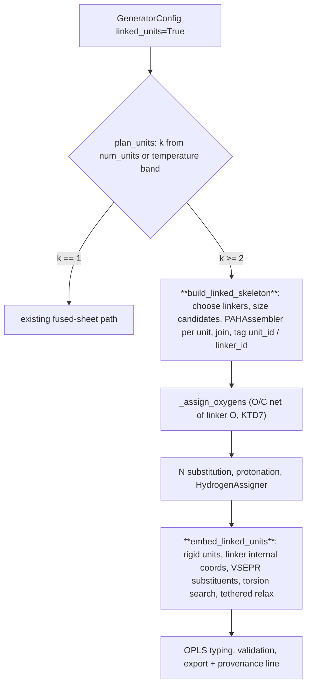

# feat: Linked multi-unit (island) structures for low HTT

## Goal Capsule

**Objective.** A user modelling a low-temperature biochar can ask the generator for a structure
made of several separate aromatic units joined by biaryl bonds, ether bridges, and propyl
bridges, with unit count and linker mix following pyrolysis temperature the way Wood, Mašek &
Erastova 2024's building blocks do, and get a strict-valid structure that exports to GROMACS.
Every existing request keeps producing exactly what it produces today.

**Means.** A new pipeline module, `src/biochar/pipeline/multi_unit.py`, builds the linked
skeleton and embeds it in 3D. `BiocharGenerator` calls it through small, opt-in hooks.

**Authority.** This plan's KTDs > issue #70 text > repository conventions in `AGENTS.md`.

**Stop conditions.** Stop and report if a linked structure cannot pass `grompp` because stock
`oplsaa.ff` lacks a bonded term for a linker (that would need a provenanced supplementary
parameter, which is force-field work outside this plan), or if the opt-in hooks cannot be added
without changing default-path output.

**Execution profile.** One PR against `main` that closes #70. Implementer: `ce-work`. Merge stays
with Josh.

---

## Product Contract

### Problem Frame

Every generated structure is one fused ring system. Wood's low-temperature blocks
(0001–0008, 0045, 0046) are 4–5 ring systems; mid-temperature blocks (0009, 0013–0016, 0052,
0053) are 3; high-temperature blocks are 1. Wood ties this "core plus arms" architecture to tuning
H/C and aromaticity independently. `PAHAssembler` grows one PAH; nothing assembles and links
several.

Profile of the reference blocks (measured 2026-10-23 from
`Biochar_MolecularModels/building_blocks/molfiles`, ring systems = rings merged when they share
atoms):

| Block | C | Ring systems | Unit carbons | Inter-unit links |
|---|---|---|---|---|
| 0001 | 48 | 5 | 10,10,10,6,6 | 2 biaryl, 2 diaryl ether |
| 0004 | 53 | 5 | 10,10,6,6,6 | 1 biaryl, 1 diaryl ketone, 2 diaryl ether |
| 0006 | 60 | 5 | 14,14,6,6,6 | 1 biaryl, 1 diaryl ether, 2 propyl |
| 0007 | 74 | 5 | 14,14,14,14,6 | 3 biaryl, 1 diaryl ether |
| 0008 | 79 | 5 | 19,19,14,10,6 | 2 diaryl ether, 2 propyl |
| 0045 (BC400) | 104 | 4 | 64,6,6,6 | 3 glycerol-type β-O-4 arms |
| 0009 | 83 | 3 | 54,12,6 | 2 propyl |
| 0013–0016 | 92–184 | 3 | core ≈ 55–75 % + 2 units | 2 diaryl ether each |
| 0052 (BC600) | 272 | 3 | 181,49,40 | 1 diaryl ether, 1 β-O-4-type |

Across 0001–0008 the 30 links are 9 biaryl, 15 diaryl ether (0003's three included), 2 diaryl
ketone Ar–C(=O)–Ar (0004, 0005), 4 propyl. Unit links form a tree (links = units − 1).

The library carries no temperature labels and does not sort cleanly by ring-system count: two-unit
blocks occur at every composition (0017–0019, 0024, 0043, 0049, 0051) and single sheets at low-T
composition (0047). The six final models are the only temperature-labelled anchors: BC400/BC400c
(0045/0046) have 4 ring systems, BC600/BC600c (0052/0053) have 3, BC800/BC800c have 1.

### Requirements

- **R1.** A config opt-in builds a structure of `k` separate aromatic units connected in a tree
  by `k − 1` linkers; with the opt-in off, output is unchanged for every existing request.
- **R2.** Linker types are biaryl (Ar–Ar single bond), diaryl ether (Ar–O–Ar), aryl–alkyl ether
  (Ar–O–CH2–Ar), and propyl bridge (Ar–CH2CH2CH2–Ar). Linker carbons carry only hydrogen and their
  bridging bonds: later oxygen placement never hydroxylates them.
- **R3.** With `temperature` set, unit count and linker mix follow Wood's temperature bands; an
  explicit count or mix overrides the band.
- **R4.** Total carbon stays within `size_tolerance` of `target_num_carbons`, and H/C and O/C are
  judged by the same strict validation as a single sheet; linker oxygen counts toward O/C.
- **R5.** The 3D structure keeps every aromatic unit flat, has non-coplanar (rotated) links, and
  passes the existing clash and bond-length validation.
- **R6.** Linker atoms type to existing OPLS-AA types and the exported topology passes `grompp`.
- **R7.** The realised unit sizes and linker census are reported to the caller and recorded in
  the exported file's provenance.

### Scope Boundaries

Non-goals:

- Glycerol-type β-O-4 arms (0045's links) and other multi-carbon oxygenated linkers — they are
  side-chain chemistry owned by #69.
- New oxygen group types (#68).
- Making islands the default at low temperature (KTD2).
- Unit-graph cycles (macrocycles of units). Wood's blocks are trees, and the oxygen stage is kept
  from closing one (U4).
- Considered and not built: an automatic retry that drops to a fused sheet when a linked build
  fails validation. A strict failure already reports why; a silent fallback would hand back a
  structure of a different architecture than requested. Evidence that would change this: sweep
  runs where linked points fail for reasons a fused sheet would not.

### Deferred to Follow-Up Work

- Diaryl ketone linker (Ar–C(=O)–Ar, 0004/0005). It needs a ketone carbonyl typing that the typer
  does not have today (a non-ring C=O carbon types as carboxyl `C`); #68 adds ring and ketone C=O.
- CLI flags (`biochar-gen --linked-units/--num-units`). CLI surface is specified in
  `rqm/cli-arguments.md` and deserves its own change. The config fields are reachable as
  `biochar-sweep` axes as soon as they exist, because the sweep validates axes against
  `GeneratorConfig` fields; a dedicated grid design, including the `linked_units` × `num_units`
  crossing that KTD2's raise makes fail, is deferred.
- Using the opt-in from `SurfaceBuilder` and `workflows/condensation.py`.

---

## Planning Contract

### Key Technical Decisions

- **KTD1. New module `pipeline/multi_unit.py`; shared files get hooks only.** (session-settled:
  user-directed — chosen over extending `PAHAssembler` in `carbon_skeleton.py`: three parallel
  lanes own `heteroatom_assignment.py`, `carbon_skeleton.py`/temperature model, and
  `geometry_3d.py`, and their PRs merge first.) The module calls `PAHAssembler.generate` per unit
  and imports `attach_aliphatic_carbons` and the private geometry helpers it needs; it edits none
  of the three lane files. `biochar_generator.py` belongs to no lane and takes the hooks.
- **KTD2. Opt-in, default off.** (session-settled: user-directed — chosen over islands-by-default
  at low HTT: existing snapshots and lane PRs must stay unaffected.) New `GeneratorConfig` fields:
  `linked_units: bool = False`, `num_units: Optional[int] = None`,
  `linker_mix: Optional[Dict[str, float]] = None`. Setting `num_units` or `linker_mix` without
  `linked_units=True` raises `ValueError` rather than being ignored.
- **KTD3. Temperature bands anchored on Wood's final models; the bands are a design choice.**
  The anchors are the six temperature-labelled final models (BC400 = 4 ring systems, BC600 = 3,
  BC800 = 1). Band edges sit at the midpoints: below 500 °C, 4–5 units (seeded choice), low-T
  mix; 500–700 °C, 3 units, mid-T mix; 700 °C and above, 1 unit, which runs the ordinary
  fused-sheet path. No temperature: 4 units, low-T mix. Two-unit structures, common in the
  library, are reachable only through an explicit `num_units=2`. Low-T mix from the 0001–0008
  links that this PR can build (ketones deferred): diaryl ether 0.54 (15/28), biaryl 0.32 (9/28),
  propyl 0.14 (4/28). Mid-T mix: diaryl ether 0.65, aryl–alkyl ether 0.20 as a stand-in for
  0052/0053's Ar–C–C–O–Ar links until #69, propyl 0.15, biaryl 0; these weights are a judgment
  from 0009/0013–0016/0052/0053, not counts. The constants' inline provenance says exactly this.
- **KTD4. Sizing: core plus arms, chosen by H/C.** Linker carbons are drawn first, then the
  aromatic budget is split into one core and `k − 1` arms. Arm sizes snap to sizes
  `PAHAssembler` builds exactly (6, 10, 14, 16, 18, … from the library), are at least 6 C and
  never exceed the core; the core is built last and absorbs the remainder, because only growth
  hits an arbitrary count. Candidate core fractions from 0.3 to 0.8 are built (each is fast),
  and the candidate whose saturated H/C is closest to the target wins, mirroring the existing
  elongation choice. If the best candidate still sits below the target by more than 0.02,
  pendant methyls are added with `attach_aliphatic_carbons` exactly as the fused path does, with
  the core budget reduced so total C stays near N. Splitting adds perimeter, so k units have an
  H/C floor; `plan_units` estimates it (largest compact core plus 6 C arms) and shrinks a
  band-derived k with a warning when the floor exceeds the target's upper tolerance, and warns
  for an explicit `num_units` (strict validation then reports the miss).
- **KTD5. Ring defects apply to the core only.** `defect_fraction`/`heptagon_fraction` pass to the
  core build; arm units are pure-hex library PAHs. Wood's arm units are benzene, naphthalene,
  anthracene/phenanthrene and pyrene-size; small grown units with pentagons are both
  unrepresentative and likelier to fail growth.
- **KTD6. Own rigid-fragment embedder; bypass `CoordinateGenerator.generate_3d_coordinates`.**
  The default embedder cannot serve island structures: above 80 heavy atoms it lays everything
  out flat (hex lattice or Kamada–Kawai) and skips the force field, which would make the links
  coplanar and put biaryl ortho hydrogens in contact. The new embedder places each unit rigidly
  from its own hex-lattice coordinates (`init_x`/`init_y`, already set by `PAHAssembler`), builds
  linker atoms from internal coordinates (bond, angle, torsion), places substituents and
  hydrogens by local VSEPR rules, then searches link torsions to minimise clash overlap using the
  same clash floors the validator uses. Torsions cannot fix contacts inside a unit (coves, bays;
  docs/solutions/bugs/flat-lattice-overlaps-at-helicene-edges.md), so the two relief stages of
  `relieve_lattice_crowding` run next as separate calls: `_tilt_crowded_substituents`, then
  `_tethered_lattice_relax` (ring atoms tethered). The relaxed result is kept only when it adds
  no bond-length or clash defect and every unit's own best-fit plane RMS stays within
  `LATTICE_MAX_SHEET_RMS`. `relieve_lattice_crowding` itself is not called: its single plane
  over all ring atoms rejects any structure whose units are rotated apart. Unit membership travels on atom properties (`unit_id`, `linker_id`) set at
  skeleton time, which survive the oxygen and hydrogen stages as `init_x` already does.
- **KTD7. Linker oxygen counts toward the O/C target; linkers stay as built.** `OxygenAssigner`
  derives its oxygen count from `num_carbons × O_C_ratio` and ignores oxygen already present. The
  hook in `BiocharGenerator._assign_oxygens` passes the ratio net of linker oxygen (floored at
  0), so the realised O/C, which counts every O, lands on target. Its aliphatic spill takes any
  sp3 carbon with a free valence, which would turn Ar–O–CH2–Ar into a hemiacetal; the builder
  therefore saturates linker carbons with explicit hydrogens at skeleton time, leaving no free
  valence to take. A bridging group the oxygen stage places across two units (an explicit
  `ether` at the ortho carbons of a biaryl closes a furan) would merge ring systems and cycle the
  unit tree; the hook detects a non-linker O or S bonded to two `unit_id`s and re-runs placement
  on derived seeds, raising in strict mode if every attempt bridges. All of this stays out of
  `heteroatom_assignment.py` (KTD1).
- **KTD8. Census on the generator, provenance in the file.** A `LinkedSkeleton` record (unit
  carbon counts, linker counts by type) is stored on `BiocharGenerator.linked_units`, surfaced as
  an optional trailing `BiocharResult.linked_units` field (positional unpacking unchanged), and
  written as one line by `_provenance_lines` into the `.top`/`.itp` headers. Linker counts are not mixed into
  `CompositionResult.functional_groups`, whose keys feed the strict functional-group checks.

### Assumptions

- The temperature bands and mixes (KTD3) are a design choice anchored on the six final models,
  not a fit to the 57-block library, which carries no temperature labels. They are named
  constants with that provenance so a later fit can replace them.
- Island structures are a structural choice made by the caller; temperature mode does not switch
  them on by itself (KTD2).
- Wood's own blocks place arms on a core and chain small units; a random tree with parent bias
  toward the core reproduces both shapes closely enough for MD starting structures.

### High-Level Technical Design

Generation with the opt-in on. Boxes in bold are new; the rest is the existing pipeline.



Embedder stages (directional):

```text
for each unit (tree order, core first):
    body := unit atoms + their substituents/H, coordinates in the unit's own plane
    if not core:
        place linker atoms from parent attachment carbon by (bond, angle, torsion)
        rigid-transform body so its attachment carbon closes the last linker bond
repeat T trials: resample link torsions -> score = sum of overlap depth below clash floor
keep best; tethered UFF relax; accept only if defects do not increase and units stay flat
```

---

## Implementation Units

### U1. Config surface and unit planning

**Goal:** Add the opt-in fields and the pure function that turns config into a unit plan.

**Requirements:** R1, R3; KTD2, KTD3.

**Dependencies:** none.

**Files:** `src/biochar/pipeline/biochar_generator.py`, `src/biochar/pipeline/multi_unit.py`
(new), `src/biochar/constants.py` (band and mix constants), `tests/test_multi_unit.py` (new),
`tests/fixtures/default_path_baseline.json` (new), `tests/test_default_path_baseline.py` (new).

**Approach:**
0. Before any source edit, capture a default-path baseline from the unmodified code: canonical
   SMILES and coordinates rounded to 1e-3 Å for a fixed matrix (several seeds; sizes on both
   sides of the 80-heavy-atom embedding split; temperature unset and set; explicit
   `functional_groups` on and off). Commit it as a fixture with a fast-tier test that compares
   current output against it.
1. Add the three fields to `GeneratorConfig` with comments in the file's style; validate in
   `__post_init__`: `num_units ≥ 1`; `linker_mix` keys in the four linker names, weights ≥ 0
   with a positive sum; `num_units`/`linker_mix` without `linked_units` raise; an explicit
   `num_units` too large for `target_num_carbons` (6 C per unit plus linker carbon) raises.
2. `plan_units(config, rng) -> UnitPlan` resolves `k` and the linker sequence. A
   temperature-derived `k` that does not fit the carbon budget shrinks with a warning instead of
   raising, because the caller did not ask for that count; the same holds for the H/C floor
   (KTD4).
3. Constants carry their Wood provenance inline (block IDs and counts).
4. Add `linked_units`, `num_units`, `linker_mix` to `generate_biochar`'s keyword arguments.

**Patterns to follow:** existing `__post_init__` validation and `MIN_BUILDABLE_AROMATICITY`
clamping with a warning.

**Test scenarios:**
- Default `GeneratorConfig()` has `linked_units` False and `to_dict`/`from_dict` round-trips the
  new fields.
- `linked_units=True, temperature=400` plans 4 or 5 units; 600 plans 3; 800 plans 1.
- `linked_units=True` with no temperature plans 4 units with the low-T mix.
- Explicit `num_units=3` at `temperature=400` plans 3.
- `linker_mix={"biaryl": 1.0}` yields only biaryl links.
- `num_units=0`, an unknown linker key, all-zero weights, and `num_units=3` without
  `linked_units` each raise `ValueError`.
- `num_units=6, target_num_carbons=30` raises; `temperature=400, target_num_carbons=20` shrinks
  `k` and warns.
- `temperature=600, feedstock="wood"` at 50 C (H/C target 0.32, unreachable for 3 units) shrinks
  `k` with a warning; the same at 272 C keeps 3.
- The baseline test passes against the unmodified code and keeps passing after every unit.

**Verification:** config tests pass; default-path snapshot tests unchanged.

### U2. Linked skeleton builder

**Goal:** Build the linked carbon/oxygen skeleton from a unit plan.

**Requirements:** R1, R2, R4; KTD4, KTD5, KTD7.

**Dependencies:** U1.

**Files:** `src/biochar/pipeline/multi_unit.py`, `tests/test_multi_unit.py`.

**Approach:**
1. Build each unit with `PAHAssembler(seed=derived).generate(n)`; defects only on the core.
2. Join units into one `RWMol`, preserving `init_x`/`init_y`, and tag `unit_id` on unit atoms.
3. Attach each non-core unit to a parent (biased toward the core) through its linker at edge
   carbons with a free valence, preferring sites not adjacent to an existing attachment; tag
   linker atoms with `linker_id` and saturate linker carbons with explicit H (KTD7).
4. Evaluate candidate core fractions, choose by saturated H/C (KTD4), add methyls when needed.
5. Return a `CarbonSkeleton` (via `PAHAssembler._make_skeleton`) plus the `LinkedSkeleton`
   census.

**Patterns to follow:** `BiocharGenerator._generate_carbon_skeleton` for the H/C arithmetic and
candidate choice; `_safe_sanitize` + `_fix_heteroatom_bond_types` after bond edits.

**Test scenarios:**
- For k in 3, 4, 5 the skeleton has exactly k ring systems (rings merged by shared atoms, the
  measure used for Wood's blocks) and k − 1 linkers.
- Forcing each single linker type produces that motif: a non-ring C–C single bond between two
  aromatic carbons of different units; an acyclic O bonded to two aromatic carbons; O bonded to
  one aromatic C and one CH2 bonded to an aromatic C; three non-ring sp3 carbons in a chain.
- Total carbons within `size_tolerance` of target for 60, 104 and 150 C.
- Every unit has at least 6 C; the core is the largest.
- Same seed gives the same SMILES; different seeds can differ.
- Unit atoms carry `unit_id` and linker atoms `linker_id`; every carbon carries a lattice
  position or is a linker/methyl carbon.
- Linker carbons have no free valence after building, so a high-O/C, propyl-only request ends
  with no O on any linker carbon.

**Verification:** builder tests pass in the fast tier.

### U3. Rigid-fragment 3D embedder

**Goal:** Embed a fully decorated linked molecule in 3D with flat units and rotated links.

**Requirements:** R5; KTD6.

**Dependencies:** U2.

**Files:** `src/biochar/pipeline/multi_unit.py`, `tests/test_multi_unit.py`.

**Approach:**
1. Per unit body: lattice coordinates at z = 0, substituents and H placed outward by local
   geometry (in-plane for aromatic parents, tetrahedral for sp3, bent for 2-coordinate O).
2. Linker atoms from internal coordinates with standard lengths and angles (C–C 1.48 Å biaryl,
   1.53 Å sp3; C–O 1.37/1.43 Å; C–O–C ≈ 118°, C–C–C ≈ 112°).
3. Torsion search over link torsions with a seeded RNG, scored by overlap depth against the
   validator's clash floors and excluded pairs.
4. Tilt crowded substituents, then the tethered UFF relax with KTD6's per-unit acceptance rule;
   set the conformer on the molecule.

**Technical design:** use an explicit NeRF-style placement for linker atoms; torsion moves rotate
the downstream subtree of the unit tree about the link bond.

**Patterns to follow:** `geometry_3d._place_untagged_heavy_atom` and `_bent_hydrogen_position`
for in-plane placement; `relieve_lattice_crowding`'s accept-only-if-not-worse rule. The private
geometry helpers are imported, not copied; their names go in the PR's "Expected rebase" list.

**Test scenarios:**
- A 104 C, 4-unit structure has no clash and no bond-length errors from
  `GeometryValidator.validate_geometry`.
- Each unit's best-fit plane RMS is within `LATTICE_MAX_SHEET_RMS`.
- At least one biaryl link has an inter-ring torsion between 20° and 160°.
- Seeded runs give identical coordinates.
- Every atom, hydrogens included, gets a finite coordinate.
- A core with a cove and a phenolic in a bay passes validation with no clash.

**Verification:** embedder tests pass; per-case runtime noted, `slow` marker on any case over a
few seconds.

### U4. Generator hooks

**Goal:** Route an opted-in config through the new module with no change to the default path.

**Requirements:** R1, R4, R7; KTD7, KTD8.

**Dependencies:** U1–U3.

**Files:** `src/biochar/pipeline/biochar_generator.py`, `tests/test_multi_unit.py`.

**Approach:**
1. `_generate_carbon_skeleton`: when the plan has k ≥ 2, return `build_linked_skeleton` and
   store the census; otherwise run the existing code untouched.
2. `_assign_oxygens`: subtract linker O from the O/C target when linked, and reject a bridging
   group across units (KTD7).
3. `_generate_geometry`: when linked, call `embed_linked_units` instead of
   `generate_3d_coordinates`, then run the existing validation and planarity report.
4. `BiocharResult.linked_units` trailing optional field; `_provenance_lines` adds
   "linked units: 4 (64, 10, 6, 6 C); links: 2 diaryl ether, 1 biaryl", emitted before its
   early return for `pH is None`.

**Test scenarios:**
- Covers R1: with `linked_units=False`, output matches the pre-change baseline fixture (U1).
- End to end, BC400-like request (104 C, H/C 0.635, O/C 0.19, `temperature=400`,
  `feedstock="wood"`, `linked_units=True`) passes strict validation for three seeds with 4–5 ring
  systems (mark `slow` per case if over a few seconds).
- BC600-like request (272 C, `temperature=600`, `feedstock="wood"`) gives 3 ring systems and
  passes strict.
- 800 °C with `linked_units=True` gives the same structure as without the opt-in.
- O/C lands within tolerance when every link is a diaryl ether.
- The exported `.top` and `.itp` headers name the units and links; `result.linked_units` matches.
- Composition with explicit `functional_groups` (including `ether`) plus linked units still
  places the requested groups and keeps k ring systems.

**Verification:** fast tier and full suite green, 1 skip.

### U5. Typing and grompp coverage for linker chemistry

**Goal:** Prove each linker types to existing OPLS-AA types and passes `grompp`.

**Requirements:** R6.

**Dependencies:** U4.

**Files:** `tests/test_multi_unit.py`, `tests/test_grompp_smoke.py` (one parametrised case).

**Approach:** generate one small structure per forced linker type, check internal types
(CT/HC for bridge carbons, OS for linker O, CA for biaryl carbons), and run the existing
`grompp` smoke helper on the export. A missing bonded term triggers the stop condition.

**Test scenarios:**
- Propyl bridge carbons type CT with HC hydrogens.
- Diaryl and aryl–alkyl ether oxygens type OS.
- Biaryl carbons type CA.
- For each linker type, `grompp` accepts the topology (requires `gmx`).

**Verification:** grompp cases pass with `gmx` on PATH; skip count stays at 1.

### U6. Requirements and docs

**Goal:** Specify the capability in `rqm/` and point the architecture docs at it.

**Requirements:** R1–R7.

**Dependencies:** U1–U5 (scenario IDs referenced from tests).

**Files:** `rqm/linked-units.md` (new), `rqm/ARCHITECTURE.md`, `rqm/registry.json` (regenerated),
`CLAUDE.md` (module map line), `tests/test_multi_unit.py` (rq IDs in comments).

**Approach:** Feature API section for the three config fields, `build_linked_skeleton`,
`embed_linked_units`, `LinkedSkeleton`; Gherkin scenarios for R1–R7; stamp IDs and run
`bash tools/rqm/rq index`; `rq check` shows the new scenarios defended.

**Test expectation:** none -- documentation; `rq check` is the gate.

**Verification:** `rq check` reports no undefended scenario in `linked-units.md`.

---

## Verification Contract

```bash
export GMXDATA="/opt/miniconda3/envs/biochar/share/gromacs"
export PATH="/opt/miniconda3/envs/biochar/bin:$PATH"
python -m pytest -m "not slow" -n auto
python -m pytest -n auto
bash tools/rqm/rq index && bash tools/rqm/rq check
```

The full run must show exactly 1 skip. Ruff via the pre-commit gate.

## Definition of Done

- All units' test scenarios exist and pass; full suite green with 1 skip.
- Default-path output matches the pre-change baseline fixture.
- `rqm/linked-units.md` written and indexed.
- PR against `main` closes #70, lists key decisions, and names each touched shared file under
  "Expected rebase".

## Sources & Research

- Issue #70, with #68 and #69 for context.
- Wood, Mašek & Erastova 2024, doi:10.1016/j.xcrp.2024.102036 (the issue text cites 102037; the repo's
  constants and data use 102036); block profile above.
- `src/biochar/pipeline/biochar_generator.py` (`_generate_carbon_skeleton`, `_assign_oxygens`,
  `_generate_geometry`), `geometry_3d.py` (2D-first path above 80 heavy atoms,
  `_tethered_lattice_relax`), `heteroatom_assignment.py` (O/C-mode oxygen count ignores existing
  O), `oplsaa.ff/ffbonded.itp` (CA–OS–CA, CT–OS–CA, CA–CT–CT, CA–CT–OS angles present).
- Side-session note `skeleton-failures.md`: RDKit kekulization fails on large sheets, which is
  why the embedder avoids whole-molecule ETKDG.
